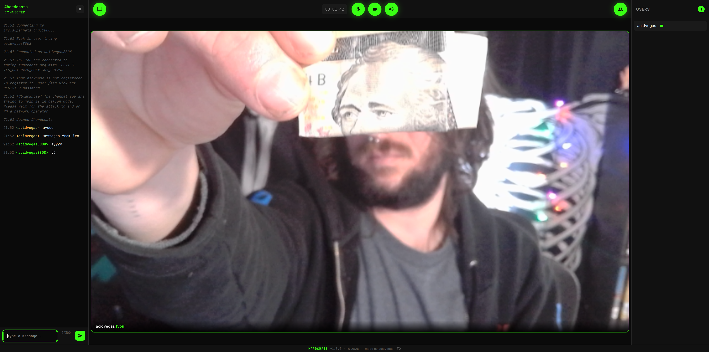

# HARDCHATS



End-to-end encrypted voice & video chat rooms. No accounts, no admins, and nobody in the room ever sees your IP.

## About
HARDCHATS is a self-hosted voice, video & screen sharing room that runs in the browser. Media flows through a [LiveKit](https://github.com/livekit/livekit) SFU, so every participant uploads their streams once no matter how many people are in the room, and peers only ever talk to the server, never to each other.

Every audio & video frame is encrypted in the browser before it leaves, so neither the SFU nor the app server can listen in. The room is intentionally admin-less: there are no moderators, roles, kicks or bans, just a captcha at the door and a few self-defense tools for whoever is inside.

## Features
- **End-to-end encryption** for voice, video and screen sharing, with a separate key per participant and key rotation whenever someone leaves
- **IP privacy**: browsers only connect to the server, so participants never learn each other's addresses
- **Scales past small groups**: SFU forwarding with simulcast and dynacast, each person uploads once
- **Gets through restrictive networks**: UDP, ICE over TCP, and built-in TURN over UDP & TLS
- **No accounts**: pick a handle, solve a captcha, you're in
- **Self-moderation**: per-user volume and hide video, global mute, and DEFCON mode (newcomers join muted with their video hidden)
- **Car mode** (audio only, low bitrate), **low bandwidth mode**, noise suppression, speaker / earpiece routing on phones, picture-in-picture
- **IRC sidebar** that bridges the room into an IRC channel, plus a built-in IRC bot that announces joins and leaves
- **Hidden dial codes** on the in-app dialpad for room-wide effects, a soundboard, a voice changer and recording
- **Installable** as a web app on desktop and mobile

## How it works
```
              app signaling, captcha, presence,
             sealed key exchange (WebSocket)
  browser  <──────────────────────────────────>  hardchats server (aiohttp)
     │                                                   │
     │  encrypted audio / video frames                   │  room tokens, kicks
     │  (WebRTC: UDP 7882, TCP 7881, TURN 3479 / 5349)   │  (LiveKit API)
     └────────────────────────>  LiveKit SFU  <──────────┘
```

- **Joining**: the hardchats server checks the captcha and hands the browser a short-lived LiveKit token. The server's WebSocket stays the source of truth for who is in the room and their mic, camera & screen state.
- **Encryption**: each browser generates an ECDH P-256 key pair and a random sender key. Sender keys are sealed per recipient (ECDH -> HKDF -> AES-GCM) and relayed over the WebSocket. Frames are encrypted with LiveKit's insertable-streams E2EE (AES-GCM). The server and the SFU only ever see public keys and ciphertext.
- **Trust model**: a passive server or SFU can't decrypt anything. Public keys are relayed by the server and there is no out-of-band verification, so a server that was actively malicious could swap them.
- **Leaving**: when someone leaves, everyone still in the room rotates their sender key, so the departed user can't decrypt anything sent afterwards.

## Requirements
- A Linux server with Docker, a public IPv4 address (IPv6 optional) and a domain
- nginx and certbot (Let's Encrypt) for HTTPS
- These ports open to the internet:

| Port | Protocol | Used for                                  |
|------|----------|-------------------------------------------|
| 443  | TCP      | Website, app WebSocket, LiveKit signaling |
| 7882 | UDP      | Media (ICE)                               |
| 7881 | TCP      | Media over TCP when UDP is blocked        |
| 3479 | UDP      | TURN over UDP, and the STUN server        |
| 5349 | TCP      | TURN over TLS (strict firewalls)          |

## Setup

#### Configure
```bash
git clone https://github.com/acidvegas/hardchats.git && cd hardchats
cp .env.example .env
docker run --rm livekit/livekit-server:v1.13.11 generate-keys   # put the pair in LIVEKIT_API_KEY / LIVEKIT_API_SECRET
```

| Variable             | Description                                                          |
|----------------------|----------------------------------------------------------------------|
| `LIVEKIT_URL`        | Public LiveKit signaling URL, e.g. `wss://hardchats.com/livekit`     |
| `LIVEKIT_API_KEY`    | LiveKit API key                                                      |
| `LIVEKIT_API_SECRET` | LiveKit API secret                                                   |
| `IRC_SERVER`         | IRC server the sidebar connects to over WebSocket                    |
| `IRC_PORT`           | IRC WebSocket port                                                   |
| `IRC_CHANNEL`        | IRC channel the sidebar joins                                        |
| `IRCBOT_ENABLED`     | `1` runs the built-in IRC bot, `0` disables it                       |
| `ZULIP_BOT_EMAIL`    | Zulip bot email for join / leave announcements (optional)            |
| `ZULIP_BOT_KEY`      | Zulip bot key, leave empty to disable                                |
| `DIAG_LOGS`          | `1` streams every browser's media & E2EE debug log to the server log |
| `FOOTER_NOTICE`      | Optional HTML shown in the footer next to the version                |

`livekit.yaml` uses `hardchats.com` as the TURN domain and certificate path. Change it if you host under another domain.

#### HTTPS & nginx
```bash
sudo certbot certonly --standalone -d hardchats.com
```

```nginx
server {
    listen 80;
    listen [::]:80;
    server_name hardchats.com;

    return 301 https://$host$request_uri;
}

server {
    listen 443 ssl;
    listen [::]:443 ssl;
    server_name hardchats.com;

    ssl_certificate     /etc/letsencrypt/live/hardchats.com/fullchain.pem;
    ssl_certificate_key /etc/letsencrypt/live/hardchats.com/privkey.pem;

    location / {
        proxy_pass http://127.0.0.1:58080;
        proxy_http_version 1.1;

        proxy_set_header Host $host;
        proxy_set_header X-Real-IP $remote_addr;
        proxy_set_header X-Forwarded-For $proxy_add_x_forwarded_for;
        proxy_set_header X-Forwarded-Proto $scheme;

        proxy_set_header Upgrade $http_upgrade;
        proxy_set_header Connection "upgrade";
    }

    location /livekit/ {
        proxy_pass http://127.0.0.1:7880/;
        proxy_http_version 1.1;

        proxy_set_header Host $host;
        proxy_set_header X-Real-IP $remote_addr;
        proxy_set_header X-Forwarded-For $proxy_add_x_forwarded_for;
        proxy_set_header X-Forwarded-Proto $scheme;

        proxy_set_header Upgrade $http_upgrade;
        proxy_set_header Connection "upgrade";
        proxy_read_timeout 3600s;
    }
}
```

`helpers/setup.reverse.proxy.sh` creates the certificate and this config in one go.

#### Run
```bash
./setup.sh
```

This builds the app image and starts two containers: `hardchats` (the web app on `127.0.0.1:58080`) and `hardchats-livekit` (the SFU on the host network). LiveKit loads its TLS certificate at startup, so restart it after every renewal, e.g. with a certbot deploy hook:

```sh
# /etc/letsencrypt/renewal-hooks/deploy/hardchats-livekit.sh
#!/bin/sh
case " $RENEWED_DOMAINS " in
	*" hardchats.com "*) docker restart hardchats-livekit >/dev/null ;;
esac
```

For production, raise the UDP buffer limits LiveKit asks for:

```bash
printf 'net.core.rmem_max = 5000000\nnet.core.wmem_max = 5000000\n' | sudo tee /etc/sysctl.d/90-livekit-udp.conf
sudo sysctl --system
```

#### IRC sidebar (UnrealIRCd)
The sidebar connects straight from the browser to your IRC server over a TLS WebSocket.

```
listen {
    ip *;
    port 7000;
    options {
        tls;
        websocket { type text; }
    };
    tls-options {
        certificate "tls/irc.crt";
        key "tls/irc.key";
        options { no-client-certificate; }
    };
};

loadmodule "webserver";
loadmodule "websocket";
loadmodule "websocket_common";
```

`no-client-certificate` is required for Chromium-based browsers to connect.

## Testing
`helpers/` holds end-to-end tests that drive headless Chromium & Firefox clients (fake camera & mic) against a live deployment. They check that media flows, frames decode, the SFU only ever sees ciphertext and a client without keys can't decode anything, plus every feature and reconnect path.

```bash
python3 -m venv .venv-test && .venv-test/bin/pip install playwright livekit cryptography av numpy aiohttp
.venv-test/bin/playwright install chromium firefox
.venv-test/bin/python helpers/test_livekit.py https://hardchats.com/                 # everything
.venv-test/bin/python helpers/test_livekit.py https://hardchats.com/ video eve relay # or pick tests
.venv-test/bin/python helpers/load_livekit.py 10 20                                  # 10 clients, cameras on
```

The token minting & SFU checks need SSH access to the host running the `hardchats` container.

## Contribute
Come join us on `irc.supernets.org` in `#hardchats` for testing, feedback, & collaboration!

---

###### Mirrors: [acid.vegas](https://git.acid.vegas/hardchats) • [SuperNETs](https://git.supernets.org/acidvegas/hardchats) • [GitHub](https://github.com/acidvegas/hardchats) • [GitLab](https://gitlab.com/acidvegas/hardchats) • [Codeberg](https://codeberg.org/acidvegas/hardchats)
